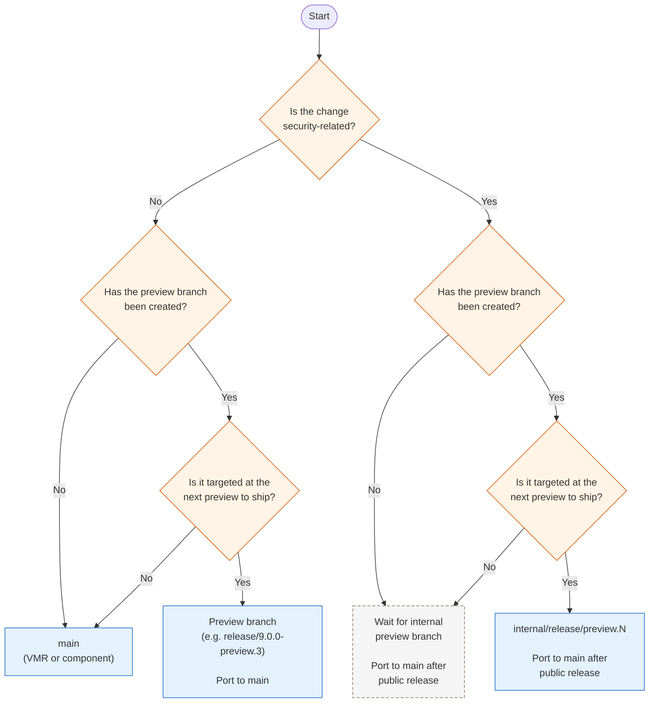
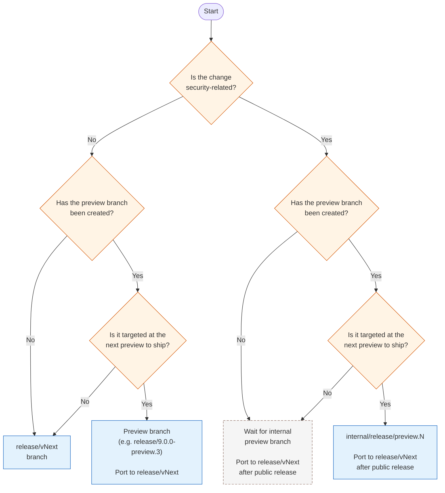
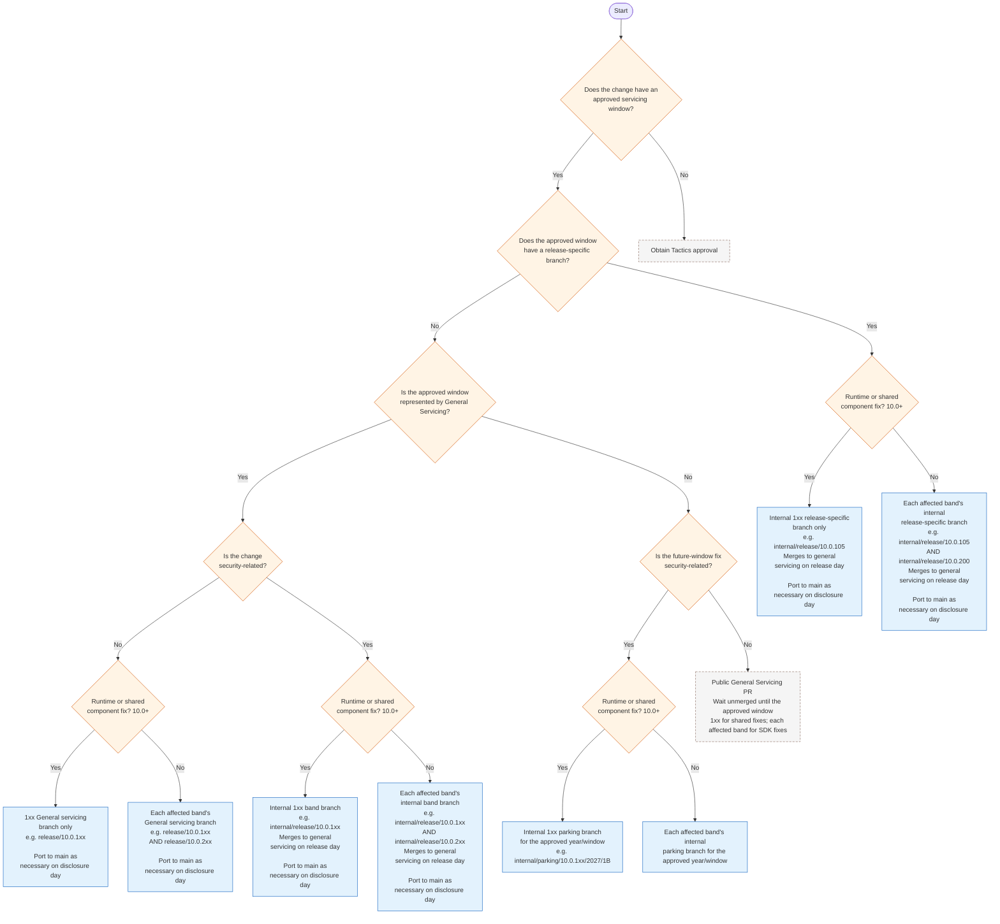

# Developer Check-in Decision Guide

This guide helps you answer “What branch can I check into for my change?” using detailed condition tables for both **vNext/vNext Preview** and **Servicing/Patch** scenarios.

**Tip: When in doubt, ask.**

See also:
- [Servicing Workflow Details](VMR-Servicing-Workflows.md)
- [Feature Band Constraints for Tooling Repo Devs](VMR-Feature-Band-Tooling-Constraints.md) — additional constraints (SDK version, source availability, etc.) when working in a non-1xx band branch.

---

## Table 1: vNext and vNext Preview Changes

### Servicing branches have not been created for vNext

| Condition(s) | Where Can I Check In? | Target branch visibility | Do I need to port the change to avoid regression? |
|--------------|----------------------|--------------------------|--------------------------------------------------|
| - Change is non-security **AND**   - Preview branch has not been created **OR** change is not targeted at next preview to ship | **main** in VMR or component repository | Public | No |
| - Change is non-security **AND**   - Preview branch has been created **AND**   - Change is targeted at next preview to ship | **Preview branch** (e.g. `release/9.0.0-preview.3`) in VMR or component repository. | Public | Yes. Port to main |
| - Change is security **AND**   - Preview branch has not been created **OR** change is not targeted at next preview to ship | **Wait** for creation of internal preview branches (e.g. internal/release/11.0.0-rc.N branch) | Internal (wait for branch creation) | **main**, **AFTER** public release. |
| - Change is security **AND**   - Preview branch has been created **AND**   - Change is targeted at next preview to ship | **internal/release/preview.N** (e.g. `internal/release/11.0.0-rc.1`) in VMR or component repository. | Internal | **main**, **AFTER** public release. |

### Servicing branches have been created for vNext

| Condition(s) | Where Can I Check In? | Target branch visibility | Do I need to port the change to avoid regression? |
|--------------|----------------------|--------------------------|--------------------------------------------------|
| - Change is non-security **AND**   - Preview branch has not been created **OR** change is not targeted at next preview to ship | **release/vNext** in VMR or component repository | Public | No |
| - Change is non-security **AND**   - Preview branch has been created **AND**   - Change is targeted at next preview to ship | **Preview branch** (e.g. `release/9.0.1xx-preview3`) in VMR or component repository. | Public | Yes. Port to release/vNext |
| - Change is security **AND**   - Preview branch has not been created **OR** change is not targeted at next preview to ship | **Wait** for creation of internal preview branches (e.g. internal/release/11.0.1xx-rcN branch) | Internal (wait for branch creation) | **release/vNext**, **AFTER** public release. |
| - Change is security **AND**   - Preview branch has been created **AND**   - Change is targeted at next preview to ship | **internal/release/preview.N** (e.g. `internal/release/11.0.1xx-rc1`) in VMR or component repository. | Internal | **release/vNext**, **AFTER** public release. |

---

## Table 2: Servicing (Patch/Hotfix) Changes

> **Multi-band note (10.0+):** For 10.0+ releases, the runtime source code only lives in the **1xx band branch** (e.g., `release/10.0.1xx`) and in release-specific branches derived from it (e.g., `internal/release/10.0.105`). Non-1xx band branches consume the runtime as build output packages that automatically flow from the 1xx build.
>
> - **Runtime / shared-component fixes** – Check the fix into the **1xx band branch only** (e.g., `release/10.0.1xx` or `internal/release/10.0.1xx`). The updated packages flow automatically to 2xx and higher band branches.
> - **SDK / band-specific fixes** – Check the fix into **each band branch** that requires it (e.g., both `release/10.0.1xx` and `release/10.0.2xx`).
>
> See [Managing SDK Bands – Servicing fixes across bands](./VMR-Managing-SDK-Bands.md#servicing-fixes-across-bands) for full details.

Choose the branch representing the **approved release window**, not necessarily the nearest calendar release. If that window has not reached General Servicing, security fixes use its internal VMR parking branch. Non-security fixes wait in unmerged PRs targeting public General Servicing until their approved window opens; do not merge them early. For example, `internal/parking/10.0.1xx/2027/1B` merges into `internal/release/10.0.1xx`, while `internal/parking/10.0.2xx/2027/1B` merges into `internal/release/10.0.2xx`. Runtime/shared fixes target only 1xx; SDK/band-specific fixes target each affected band.

NETMechanic integrates and deletes parking branches when their General Servicing window opens, after the preceding release cut. Developers do not resubmit fixes to General Servicing or later parking windows. Once the approved window is cut, new fixes go directly to its Release Specific branch. During parking integration, follow the QB's published destination and do not submit to a frozen parking branch. OOBs use the explicitly approved OOB destination and consume no parking branch. See [Release-Window Parking Branches](VMR-Servicing-Workflows.md#release-window-parking-branches).

| Condition(s) | Where Can I Check In? | Target branch visibility | Do I need to port the change to avoid regression? |
|--------------|----------------------|--------------------------|--------------------------------------------------|
| - Change is non-security **AND**   - Approved window is represented by General Servicing   - **Runtime/shared-component fix (10.0+)** | **General Servicing 1xx band branch** in VMR or component repository (e.g. `release/10.0.1xx`) | Public | Port to main as necessary on disclosure day |
| - Change is non-security **AND**   - Approved window is represented by General Servicing   - **SDK/band-specific fix (10.0+)** | **Each affected General Servicing band branch** in VMR or component repository (e.g. `release/10.0.1xx` and `release/10.0.2xx`) | Public | Port to main as necessary on disclosure day |
| - Change is non-security **AND**   - Approved window is beyond General Servicing | **Unmerged PR against public General Servicing** in VMR or component repository. Wait to merge until the approved window opens. Runtime/shared fixes target only 1xx; SDK/band-specific fixes target each affected band. | Public | Port to main as necessary; do not merge into servicing before the approved window. |
| - Change is security **AND**   - Approved window is beyond General Servicing | **Internal VMR parking branch for the approved year/window and band** (e.g. `internal/parking/10.0.1xx/2027/1B`). Runtime/shared fixes target only 1xx; SDK/band-specific fixes target each affected band. Ask the QB to prepare the window if missing. | Internal | Mechanic merges into the matching internal General Servicing branch when the window opens; no developer resubmission. Port to main as necessary on disclosure day. |
| - Change has no approved servicing window | Obtain Tactics approval before checking into servicing | N/A (no check-in yet) | N/A |
| - Change is non-security **AND**   - Release specific branches exist for the approved window (e.g. internal/release/10.0.105)   - **Runtime/shared-component fix (10.0+)** | **Internal 1xx release specific branch in VMR** (e.g. `internal/release/10.0.105`) | Internal | Will merge to General Servicing branch on release day. Port to main as necessary on disclosure day. |
| - Change is non-security **AND**   - Release specific branches exist for the approved window (e.g. internal/release/10.0.105)   - **SDK/band-specific fix (10.0+)** | **Each affected internal release specific branch in VMR** (e.g. `internal/release/10.0.105` and `internal/release/10.0.200`) | Internal | Will merge to General Servicing branches on release day. Port to main as necessary on disclosure day. |
| - Change is security **AND**   - Release specific branches exist for the approved window (e.g. internal/release/10.0.105) | **Internal release specific branch in VMR** (e.g. internal/release/10.0.105). For SDK/band-specific fixes, target each affected band's release specific branch. | Internal | Will merge to General Servicing branch on release day. Port to main as necessary on disclosure day.|
| - Change is security **AND**   - Approved window is represented by General Servicing | **Internal 1xx band branch** (e.g. `internal/release/10.0.1xx`) for runtime/shared fixes. For SDK/band-specific fixes, target each affected `internal/release/10.0.Nxx` branch. | Internal | Will merge to General Servicing branch on release day. Port to main as necessary on disclosure day. |

---

## Quick Reference Decision Diagrams

**vNext/vNext Preview (servicing branches not created):**

**vNext/vNext Preview (servicing branches created):**

**Servicing:**

